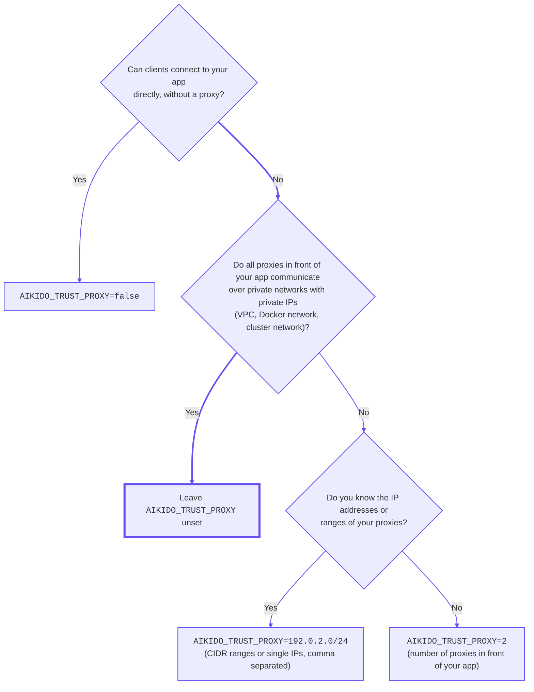

# Proxy settings

Zen automatically reads the `x-forwarded-for` header to determine the client's IP address when running behind a proxy. If you're publicly exposing your server without a load balancer in front of it, you should set the `AIKIDO_TRUST_PROXY` env var to `false` to ensure that the correct IP address is used. Otherwise, someone could potentially spoof their IP address by adding the above header and thus bypassing the rate limiting.

If you need to use a different header to determine the client's IP address, you can set the `AIKIDO_CLIENT_IP_HEADER` environment variable to the name of that header. This will override the default `x-forwarded-for` header.

```bash
# For DigitalOcean App Platform
AIKIDO_CLIENT_IP_HEADER=do-connecting-ip node app.js
```

## Advanced proxy trust configuration

The `AIKIDO_TRUST_PROXY` environment variable controls whether Zen reads the IP header at all, and how it selects the client IP from it.

| Value                              | Behavior                                                                                                                                                                                                                                                                                                                                                                                        |
| ---------------------------------- | ----------------------------------------------------------------------------------------------------------------------------------------------------------------------------------------------------------------------------------------------------------------------------------------------------------------------------------------------------------------------------------------------- |
| _(not set)_ or `true`              | **Default.** Trust the header and use the first non-private IP found, scanning from right to left. Suitable for most deployments behind a reverse proxy.                                                                                                                                                                                                                                        |
| `false`                            | Ignore the header entirely and always use the remote address of the request socket. Use this when your server is directly exposed to the internet without a proxy in front of it.                                                                                                                                                                                                               |
| `1.2.3.4/32, …` _(CIDR notation)_  | Only trusted if the request's remote address matches one of the specified CIDR ranges; otherwise the header is ignored and the remote address is used. When trusted, use the first non-private IP that does not belong to any of the specified CIDR ranges, scanning from right to left. Multiple ranges can be separated by commas. Use this when your proxies have known public IP addresses. |
| `1`, `2`, … _(positive integer n)_ | Trust the header and use the _n_-th IP from the right (1 = rightmost). Use this when a fixed number of trusted proxies are in front of your server. Private IPs are not skipped.                                                                                                                                                                                                                |

> [!WARNING]
> In the default mode (`true` or not set), Zen picks the rightmost **non-private** IP in the header. This only works if all proxies in front of your app communicate over private networks and use private IP addresses. If there is a proxy with a public IP in the chain (e.g. a CDN like Cloudflare in front of your load balancer), Zen will treat that proxy's IP as the client IP. In this case, use the CIDR or number-of-proxies mode below. If your server is directly exposed to the internet, set `AIKIDO_TRUST_PROXY=false`.

## How the client IP is selected

Each proxy appends the address it received the connection from to `x-forwarded-for`. Everything to the left of the last trusted proxy's entry can be spoofed by the client, so Zen scans from right to left and stops at the first IP that is not part of your own infrastructure.

## Choosing a mode

You can use the following flowchart to determine which mode is appropriate for your deployment:


